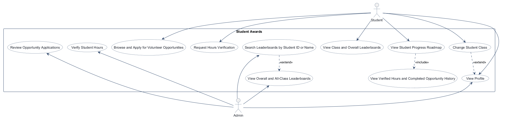
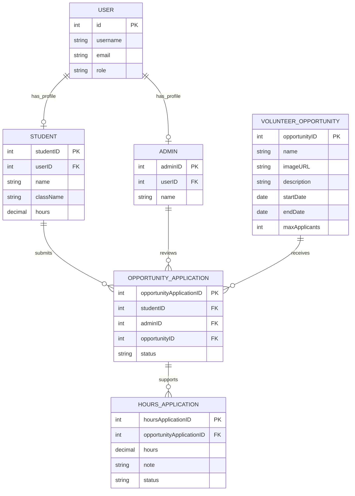
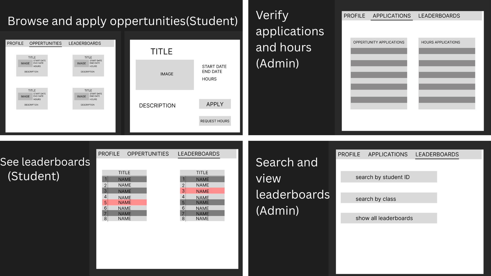
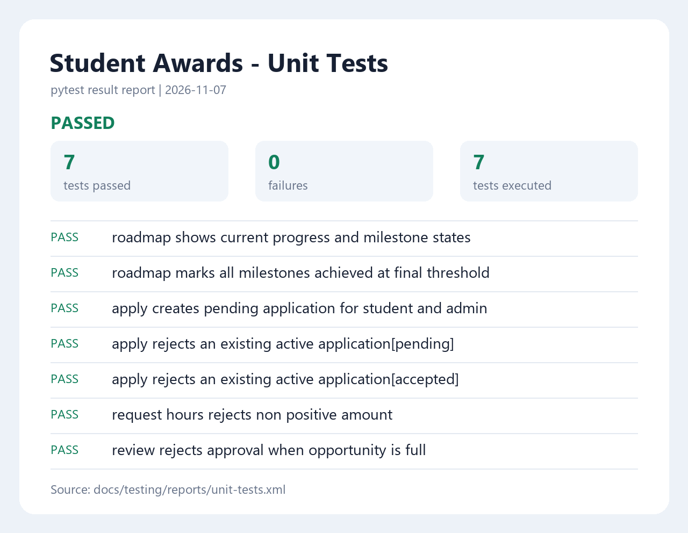
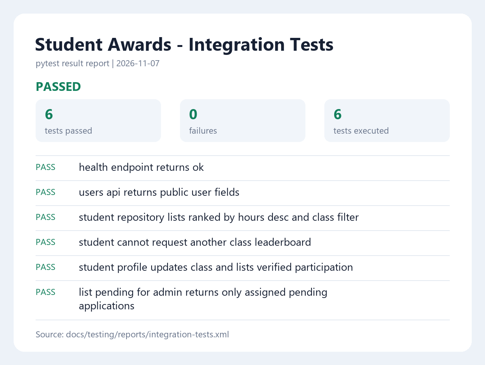
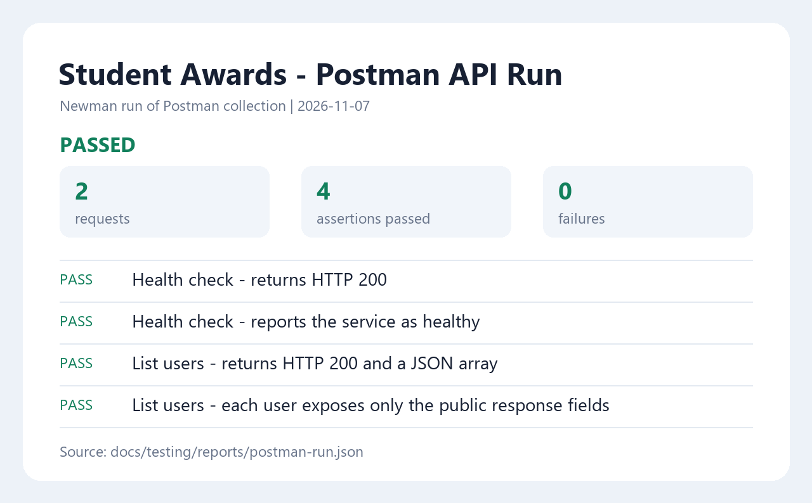

# COMP 3613 Assignment 2 — Student Awards

## Project description

Student Awards is a volunteer-hours platform. Students browse and apply for volunteer opportunities, submit completed hours for verification, and track their progress on class and overall leaderboards. Administrators review opportunity applications and verify submitted hours.

## Use case diagram

## ERD

FastStarter `User` records provide authentication. Student and Admin profiles are linked one-to-one to those accounts. Opportunity applications connect students, administrators, and volunteer opportunities. Hours applications record the requested hours and review status for an accepted opportunity application. Leaderboards and milestone progress are derived from verified student data.

## Wireframe

## Test plans

### User acceptance tests

**UAT-01 — Browse, apply, and request hours**

- **Actor and setup:** Student with available volunteer opportunities; an administrator can review the application.
- **Steps:** Browse opportunities, open one, choose an administrator, and apply. After the application is accepted, submit a positive number of hours with a note.
- **Expected result:** The application status is visible. An accepted application enables an hours request, which appears in the administrator review queue.

**UAT-02 — Review applications and verify hours**

- **Actor and setup:** Administrator with a pending opportunity application and hours request in their queue.
- **Steps:** Review the opportunity application, then approve a pending hours request.
- **Expected result:** Each review updates its status. Approved hours increase the student's verified-hours total.

**UAT-03 — View class and overall leaderboards**

- **Actor and setup:** Student with a class profile and verified hours.
- **Steps:** Open the leaderboard and switch between the overall view and the student's class view.
- **Expected result:** Students are ordered by verified hours, and the signed-in student's row is highlighted.

**UAT-04 — Search and filter leaderboards as an administrator**

- **Actor and setup:** Administrator with seeded student data.
- **Steps:** Open the leaderboard, search by student ID or name, select a class, and use the show-all view.
- **Expected result:** Search and class filters return the matching students; show-all displays the available leaderboard rows.

### Unit test plan

Unit tests isolate service logic and mock repositories where persistence is not under test.

- **UT-01 — Progress roadmap:** At 12.5 verified hours, show the current total, next milestone, progress percentage, and hours remaining.
- **UT-02 — Final milestone:** At 32 verified hours, show all milestones achieved, no next milestone, and zero hours remaining.
- **UT-03 — Submit opportunity application:** A valid student, opportunity, and administrator create a pending application.
- **UT-04 — Prevent duplicate active application:** A pending or accepted application prevents another active application.
- **UT-05 — Validate hours request:** A zero or negative amount is rejected without creating a request.
- **UT-06 — Enforce opportunity capacity:** Approval is rejected when accepted applications have filled the opportunity.

### Integration test plan

Integration tests use an isolated in-memory SQLite database.

- **IT-01 — Health check:** `GET /health` returns HTTP 200 and `{"ok": true}`.
- **IT-02 — User-list API:** `GET /api/users` returns public user fields only; password and role fields are excluded.
- **IT-03 — Ranked leaderboard:** Overall and class filters return rows in descending verified-hours order and support name/ID search.
- **IT-04 — Student class access:** A student cannot request another class's leaderboard.
- **IT-05 — Student profile:** Updating a student's class is reflected in the profile and participation records.
- **IT-06 — Admin application queue:** Pending applications are scoped to the assigned administrator.

## Implementation

**Repository:** [raidenrUWI/comp3613a1](https://github.com/raidenrUWI/comp3613a1)

**Unit tests**

- Service tests: [tests/test_student_progress_service.py](https://github.com/raidenrUWI/comp3613a1/blob/main/tests/test_student_progress_service.py) and [tests/test_opportunity_service.py](https://github.com/raidenrUWI/comp3613a1/blob/main/tests/test_opportunity_service.py).
- Run with `python -m pytest -q tests/test_student_progress_service.py tests/test_opportunity_service.py`.

**Integration tests**

- API and repository tests: [tests/test_api_integration.py](https://github.com/raidenrUWI/comp3613a1/blob/main/tests/test_api_integration.py), [tests/test_student_repository.py](https://github.com/raidenrUWI/comp3613a1/blob/main/tests/test_student_repository.py), and [tests/test_opportunity_application_repository.py](https://github.com/raidenrUWI/comp3613a1/blob/main/tests/test_opportunity_application_repository.py).
- Run with `python -m pytest -q tests/test_api_integration.py tests/test_student_repository.py tests/test_opportunity_application_repository.py`.

**API tests (Postman)**

- Collection: [postman/StudentAwards.postman_collection.json](https://github.com/raidenrUWI/comp3613a1/blob/main/postman/StudentAwards.postman_collection.json).
- The collection tests `GET /health` and `GET /api/users`; its assertions check successful responses and the public user response shape.
- Exported run: [docs/testing/reports/postman-run.json](https://github.com/raidenrUWI/comp3613a1/blob/main/docs/testing/reports/postman-run.json).

## Reports

### Unit test report

**Result:** 7 passed, 0 failed.

### Integration test report

**Result:** 6 passed, 0 failed.

### Postman collection run

**Result:** 2 requests, 4 assertions passed, 0 failed.

